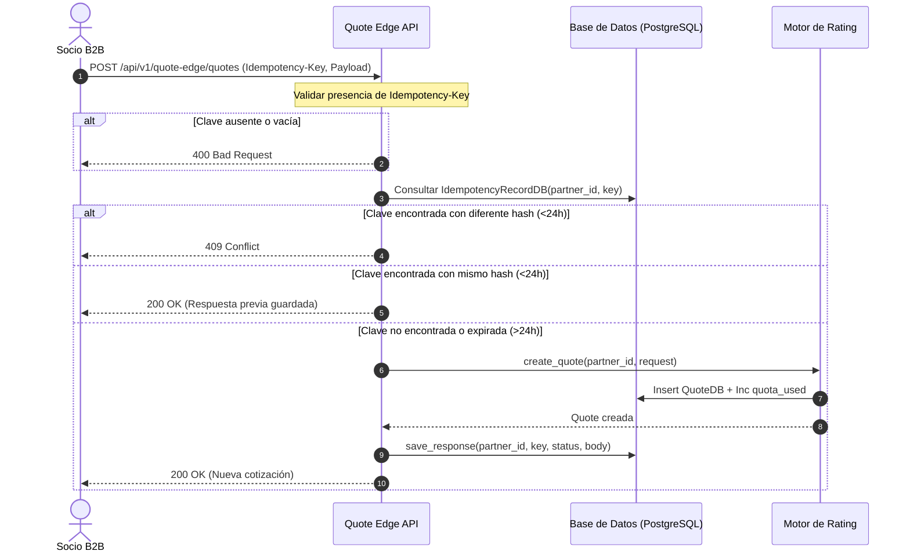

# HU-WEB-11 · Reintentar una cotización sin crear registros duplicados

| Field | Value |
|---|---|
| ID | HU-WEB-11 |
| Title | Reintentar una cotización sin crear registros duplicados |
| User story | https://github.com/proyectos-miso/proyecto-final-miso/issues/65 |
| Owner | Oscar Saraza |
| Status | DONE |
| Created | 2026-10-24 |
| Security profile | HIGH |

<!-- A spec is a contract: what, why, how, and how we will know it is done. Fill the sections in
     order and stop for agreement between them: Requirements → Design → Tasks.
     Status: DRAFT → READY (after spec-review) → IN_PROGRESS → IN_REVIEW → DONE | BLOCKED. -->

## 1. Requirements

### User story

Como socio de distribución quiero poder reintentar una solicitud cuyo resultado no recibí para no dejar al cliente sin respuesta ni ensuciar mi conciliación con cotizaciones repetidas.

| Campo | Valor |
|---|---|
| Tipo | Historia de usuario |
| Componente | Web |
| Feature | FE-WEB-06 |
| Escenario | ESC-DIS-04 |
| Prioridad | Must have |
| Estimación | 2 puntos |
| Responsable | Oscar Saraza |
| Depende de | HU-WEB-10 |

#### Criterios de aceptación (Gherkin)

1. Reintento idempotente. Dada una solicitud con un `Idempotency-Key`, cuando el socio la reenvía con la misma clave y el mismo contenido, entonces recibe la misma cotización y no se crea un registro nuevo.
2. Misma clave, otro contenido. Dada una clave ya usada, cuando se envía con un contenido diferente, entonces se rechaza con 409 y un mensaje que explica el conflicto.
3. Clave obligatoria. Dada una solicitud B2B sin `Idempotency-Key`, cuando llega, entonces se rechaza con 400.
4. Vigencia de la clave. Dada una clave usada hace más de 24 horas, cuando se reutiliza, entonces se trata como una solicitud nueva.

#### Requisitos no funcionales

- HA-05 · Degradar de forma explícita ante un tercero lento (#35)
- HA-07 · Aislar la carga entre socios con cuotas (#37)
- HA-11 · Preservar la integridad de cobros y pólizas ante fallos y reintentos (#41)

#### Tareas

- [ ] #179 HU-WEB-11.1 · Backend: idempotencia en la cotización B2B, persistida por socio y clave.
- [ ] #180 HU-WEB-11.2 · Pruebas de reintentos concurrentes y de conflicto.

### Problem and outcome

Los socios de distribución B2B integrados con Quote Edge pueden experimentar caídas de conexión, timeouts o fallas en el transporte de red antes de recibir la respuesta HTTP de una cotización. Al reintentar la solicitud sin control de idempotencia, el sistema calcula de nuevo la tarifa, consume cuota mensual (`quota_used`) innecesariamente y persiste un nuevo registro en la tabla `quotes`, provocando duplicados y dificultando la conciliación contable del socio.
Resultado: el endpoint `POST /api/v1/quote-edge/quotes` exige obligatoriamente el encabezado `Idempotency-Key`. Reintentos con la misma clave y el mismo payload retornan la cotización previa sin crear registros duplicados ni incrementar la cuota. Claves repetidas con contenido discrepante dentro de la ventana de vigencia se rechazan con HTTP 409. Claves con más de 24 horas expiran y permiten un nuevo cálculo. El aislamiento multi-tenant garantiza que las claves de un socio no colisionen con las de otros socios.

### Goals and non-goals

Objetivos:
- Exigir obligatoriamente el encabezado `Idempotency-Key` en `POST /api/v1/quote-edge/quotes`, retornando HTTP 400 Bad Request si está ausente o vacío.
- Persistir la respuesta de la cotización calculada en la tabla `idempotency_records` bajo la clave primaria compuesta `(partner_id, idempotency_key)`.
- Responder de forma idempotente con status 200 y el cuerpo previo ante reintentos con misma clave y mismo payload, sin recalcular ni duplicar registros.
- Detectar y rechazar con HTTP 409 Conflict si se reutiliza una clave activa con un payload discrepante (hash SHA-256 no coincide).
- Implementar expiración de vigencia de 24 horas para claves de idempotencia en `backend/app/core/idempotency.py` (ASR-05, HA-11), tratando claves mayores a 24 horas como solicitudes nuevas.
- Garantizar aislamiento multi-tenant estricto para que la colisión de claves entre distintos socios sea imposible.

Fuera de alcance:
- Implementación de idempotencia en el canal web interno de asesores comerciales (afecta únicamente a Quote Edge B2B).
- Almacenamiento en caché distribuido externo como Redis (se utiliza la persistencia transaccional PostgreSQL existente en `idempotency_records`).
- Modificación del esquema de base de datos de la tabla `quotes`.

### Affected paths

| Path | Change |
|---|---|
| backend/app/core/idempotency.py | Verificación de vigencia de 24 horas y soporte para reemplazo de claves expiradas |
| backend/app/bff/quote_edge/router.py | Inyección y validación obligatoria de `Idempotency-Key`, verificación de idempotencia y persistencia de respuesta |
| backend/tests/unit/test_quote_edge_idempotency.py | Pruebas unitarias de clave obligatoria, reintento exitoso, conflicto de payload, expiración de 24h y multi-tenant |
| backend/tests/integration/test_quote_edge_concurrency.py | Pruebas de concurrencia de reintentos simultáneos sin duplicación de cotizaciones |
| CHANGELOG.md | Registro de cambios bajo el estándar Keep a Changelog |
| backend/README.md | Documentación del encabezado Idempotency-Key en Quote Edge |

### Use cases

| ID | Actor | Use case | Main flow | Alternate flows |
|---|---|---|---|---|
| UC-01 | Socio B2B | Cotización inicial exitosa | 1. Envía `POST /api/v1/quote-edge/quotes` con token JWT, encabezado `Idempotency-Key` y payload válido. 2. Backend verifica que la clave sea nueva. 3. Calcula la cotización, incrementa cuota y guarda la respuesta en `idempotency_records`. 4. Retorna 200 OK con la cotización. | Encabezado ausente o vacío: retorna 400 Bad Request. Token inválido: retorna 401 Unauthorized. |
| UC-02 | Socio B2B | Reintento idempotente de cotización | 1. El socio reenvía la solicitud con la misma `Idempotency-Key` y mismo payload JSON. 2. Backend localiza el registro previo vigente (<24h) y confirma hash idéntico. 3. Retorna 200 OK con la misma cotización sin crear un nuevo registro en `quotes` ni alterar la cuota. | Si el payload tiene diferencias: retorna 409 Conflict. |
| UC-03 | Socio B2B | Reutilización de clave expirada (>24h) | 1. Envía `POST /api/v1/quote-edge/quotes` con una `Idempotency-Key` registrada hace más de 24 horas. 2. Backend identifica que la clave ha expirado. 3. Procesa la solicitud como nueva, calcula una cotización nueva y actualiza el registro de idempotencia. 4. Retorna 200 OK. | Si el payload es inválido: retorna 422 Unprocessable Entity. |

### Abuse cases

| ID | Abuse case | Actor | Threat | Expected response | Test case |
|---|---|---|---|---|---|
| AB-01 | Reutilizar una Idempotency-Key activa enviando un payload diferente para intentar modificar la cotización previa | Atacante o cliente con error de integración | THR-01 | HTTP 409 Conflict con mensaje descriptivo de discrepancia sin modificar la cotización previa | TC-02 |
| AB-02 | Omitir deliberadamente el encabezado Idempotency-Key para inundar la base de datos de cotizaciones | Atacante o cliente mal configurado | THR-02 | HTTP 400 Bad Request exigiendo la presencia del encabezado | TC-03 |
| AB-03 | Intentar utilizar la Idempotency-Key de otro socio para acceder a su cotización o bloquear sus peticiones | Socio hostil | THR-03 | Aislamiento por `partner_id`: el socio solo accede a su propio namespace de claves; no colisiona con otros socios | TC-05 |
| AB-04 | Enviar ráfagas concurrentes de peticiones idénticas con la misma clave para provocar carreras y registros duplicados | Atacante o reintentos agresivos sin backoff | THR-04 | Ejecución concurrente segura que no genera registros duplicados en `quotes` | TC-06 |

### Acceptance criteria

| ID | Criterion | Source |
|---|---|---|
| AC-01 | WHEN el socio envía una solicitud POST /api/v1/quote-edge/quotes con Idempotency-Key y luego la reenvía con la misma clave y el mismo contenido, THE backend SHALL retornar la misma cotización con HTTP 200 sin generar un nuevo registro de cotización ni incrementar quota_used | STATED |
| AC-02 | WHEN el socio envía una solicitud con una Idempotency-Key ya usada previamente pero con un payload diferente dentro de las 24 horas, THE backend SHALL rechazar la petición con HTTP 409 Conflict y mensaje de conflicto | STATED |
| AC-03 | WHEN un socio envía una solicitud POST /api/v1/quote-edge/quotes sin el encabezado Idempotency-Key o con valor en blanco, THE backend SHALL rechazar la petición con HTTP 400 Bad Request | STATED |
| AC-04 | WHEN una Idempotency-Key registrada tiene una antigüedad superior a 24 horas y se reutiliza, THE backend SHALL tratar la petición como una solicitud nueva calculando y registrando una nueva cotización | STATED |
| AC-05 | WHEN dos socios distintos envían solicitudes utilizando el mismo valor de Idempotency-Key, THE backend SHALL procesar cada solicitud de forma independiente dentro del contexto de cada socio sin generar colisiones ni fugas de información | DERIVED: HA-07 y principio de aislamiento multi-tenant |

### Quality requirements

| ID | Category | Requirement | Target and conditions |
|---|---|---|---|
| QR-01 | PERFORMANCE | Respuesta inmediata en reintentos idempotentes consultando la persistencia de idempotencia sin recalcular tarificación ni invocar buró crediticio | Latencia p95 < 50 ms en reintentos locales |
| QR-02 | MAINTAINABILITY | Reutilización del módulo core `app.core.idempotency` garantizando compatibilidad regresiva con cobros de primas | 100% de pruebas unitarias y de integración de backend pasando exitosamente |

### Security triggers

| Trigger | Applies | Rationale |
|---|---|---|
| Personal data (identifies or can identify a person) | YES | Las cotizaciones B2B procesan el documento de identidad y scoring del cliente asegurado |
| Sensitive data (special categories, biometrics, health, financial, minors) | NO | No se tratan datos de salud, biometría ni menores |
| Authentication, sessions, credentials or one-time codes | YES | Requiere autenticación de socio B2B mediante token OAuth2 JWT en el canal Quote Edge |
| Authorization or access to other users' resources | YES | Control de acceso y aislamiento estricto de cotizaciones y claves de idempotencia por socio |
| Payments or money movement | NO | El endpoint afectado es de cotización; la pasarela de pagos se maneja en otro módulo |
| Third-party services or integrations | YES | El servicio de tarificación consulta la simulación de buró crediticio externo |
| Infrastructure, network, IAM, CI/CD or secrets | NO | No se crean ni modifican componentes de infraestructura ni secretos en AWS |
| Multiple tenants, partners or organizations | YES | Múltiples socios B2B interactúan sobre la misma API requiriendo separación lógica absoluta |
| Storage or processing on a mobile device | NO | Servicio puramente backend B2B M2M |
| Web UI or data exposed in the browser | NO | Endpoint B2B sin interfaz gráfica web |
| New or updated dependencies | NO | No se introducen nuevas dependencias en el proyecto |
| Critical paths (sdd/security/critical-paths.md) | YES | Modifica componentes críticos de autenticación/idempotencia (`backend/app/core/idempotency.py` y `backend/app/bff/quote_edge/router.py`) |

### Security requirements

| ID | Requirement | Source | Controls | Priority |
|---|---|---|---|---|
| SR-01 | Requerir obligatoriamente el encabezado `Idempotency-Key` en peticiones de cotización B2B y rechazar con HTTP 400 las solicitudes que lo omitan | THR-02 | CTL-01 | HIGH |
| SR-02 | Aislar estrictamente los registros de idempotencia por partner_id impidiendo accesos cruzados o colisiones entre socios | DATA-01, THR-03 | CTL-02 | HIGH |
| SR-03 | Verificar mediante hash criptográfico SHA-256 la correspondencia exacta del payload y rechazar con HTTP 409 cualquier discrepancia para una misma clave | THR-01 | CTL-03 | HIGH |
| SR-04 | Aplicar expiración estricta de 24 horas sobre la vigencia de las claves de idempotencia permitiendo cotizar de nuevo al vencer el plazo | THR-04 | CTL-04 | MEDIUM |

## 2. Design

### Components

- `backend/app/core/idempotency.py`:
  - Se actualiza la función `find_response` para recibir o evaluar la vigencia máxima (24 horas por defecto). Si el registro encontrado tiene una antigüedad superior a 24 horas respecto a `created_at`, se ignora (retorna `None`).
  - Se actualiza `save_response` para soportar reemplazo seguro en base de datos si la clave expiró, manteniendo la consistencia de la clave primaria `(partner_id, idempotency_key)`.
- `backend/app/bff/quote_edge/router.py`:
  - En la función `create_partner_quote`:
    - Se añade el parámetro `idempotency_key: Optional[str] = Header(None, alias="Idempotency-Key")`.
    - Validación: si `idempotency_key` es `None` o una cadena vacía tras aplicar `.strip()`, se lanza `HTTPException(status_code=400, detail="El encabezado 'Idempotency-Key' es obligatorio para cotizaciones B2B")`.
    - Consulta de idempotencia previa con `find_response(session=db, partner_id=current_partner.partner_id, idempotency_key=idempotency_key, request=request)`.
    - Si se captura `IdempotencyConflictError`, se lanza `HTTPException(status_code=409, detail="Conflicto de idempotencia: la clave ya fue utilizada con una solicitud diferente")`.
    - Si existe respuesta previa guardada (`saved`), se retorna directamente `PartnerQuoteResponse(**saved.response_body)` sin crear nueva cotización ni incrementar cuota.
    - Si no existe respuesta previa, se invoca `rating_service.create_quote(...)`, se construye la respuesta, se registra en `idempotency_records` mediante `save_response` y se confirma la transacción con `db.commit()`.

### Data flows

### Data contract

- **Endpoint**: `POST /api/v1/quote-edge/quotes`
- **Encabezados**:
  - `Authorization: Bearer <jwt_partner_token>` (Obligatorio)
  - `Idempotency-Key: <cadena_unica>` (Obligatorio, longitud 1 a 128 caracteres)
- **Cuerpo de la petición**: `QuoteRequest` (JSON)
  - `document_type`: string
  - `document_number`: string
  - `vehicle_model_year`: integer
  - `coverage_type`: string
- **Códigos de respuesta**:
  - `200 OK`: `PartnerQuoteResponse` (cotización calculada o recuperada por idempotencia)
  - `400 Bad Request`: `{"detail": "El encabezado 'Idempotency-Key' es obligatorio para cotizaciones B2B"}`
  - `401 Unauthorized`: Token no proporcionado, inválido o de socio inactivo
  - `409 Conflict`: `{"detail": "Conflicto de idempotencia: la clave ya fue utilizada con una solicitud diferente"}`
  - `422 Unprocessable Entity`: Error de validación en los campos del cuerpo JSON

### Security design decisions

| Decision | Implements | Rejected alternative and why |
|---|---|---|
| Clave compuesta por `(partner_id, idempotency_key)` en persistencia | CTL-02, SR-02 | Clave única global por `idempotency_key`: rechazada porque permitiría colisiones accidentales o denegación de servicio entre socios independientes |
| Hash SHA-256 canónico del payload normalizado vía `model_dump_json()` | CTL-03, SR-03 | Comparar payloads como strings crudos: rechazada porque variaciones de whitespace o formateo JSON provocarían falsos conflictos |
| Ventana de vigencia de 24 horas evaluada al consultar y reemplazar registros | CTL-04, SR-04 | TTL automático en Redis: rechazada porque la arquitectura define persistencia transaccional ACID en PostgreSQL |
| Obligatoriedad de `Idempotency-Key` en Quote Edge B2B con rechazo 400 | CTL-01, SR-01 | Clave opcional: rechazada porque la especificación del negocio y el criterio 3 exigen rechazo explícito con 400 ante omisión |

### Architecture decisions

N/A: implementa los patrones definidos en ADR 0001 (API First), ADR 0003 (Arquitectura Hexagonal Backend) y las directrices de diseño ASR-05, HA-07 y HA-11.

### Configuration and deployment

No se requieren variables de entorno nuevas. Se utiliza la conexión de base de datos existente y el tiempo de vigencia de 24 horas definido en constantes de configuración de idempotencia.

## 3. Tasks

| ID | Task | Traces to | Controls | Status | Evidence |
|---|---|---|---|---|---|
| T-01 | #179 HU-WEB-11.1 · Backend: idempotencia en la cotización B2B, persistida por socio y clave | AC-01, AC-02, AC-03, AC-04, AC-05, SR-01, SR-02, SR-03, SR-04 | CTL-01, CTL-02, CTL-03, CTL-04 | DONE | backend/app/bff/quote_edge/router.py |
| T-02 | #180 HU-WEB-11.2 · Pruebas de reintentos concurrentes y de conflicto | AC-01, AC-02, AC-03, AC-04, AC-05, SR-01, SR-02, SR-03, SR-04 | CTL-01, CTL-02, CTL-03, CTL-04 | DONE | backend/tests/unit/test_quote_edge_idempotency.py |
| T-03 | Documentación del encabezado en API y registro en CHANGELOG.md | AC-01, AC-03 | — | DONE | CHANGELOG.md, backend/README.md, README.md |
