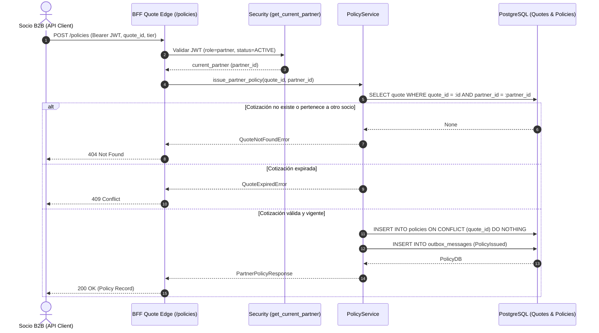

# HU-WEB-14 · Emisión de póliza embebida B2B

| Field | Value |
|---|---|
| ID | HU-WEB-14 |
| Title | Emisión de póliza embebida B2B |
| User story | https://github.com/proyectos-miso/proyecto-final-miso/issues/113 |
| Owner | Oscar Saraza |
| Status | DRAFT |
| Created | 2026-10-24 |
| Security profile | HIGH |

<!-- A spec is a contract: what, why, how, and how we will know it is done. Fill the sections in
     order and stop for agreement between them: Requirements → Design → Tasks.
     Status: DRAFT → READY (after spec-review) → IN_PROGRESS → IN_REVIEW → DONE | BLOCKED. -->

## 1. Requirements

### User story

**Como** socio de distribución B2B,  
**quiero** formalizar la compra de la póliza desde mi canal con el ID de cotización,  
**para** cerrar la venta digital embebida otorgando cobertura inmediata al cliente.

| Campo | Valor |
|---|---|
| **Tipo** | Historia de usuario |
| **Componente** | Web |
| **Feature** | FE-WEB-06 · API B2B de socios |
| **Escenario** | ESC-LAT-01, ESC-DIS-03 |
| **Prioridad** | Must have |
| **Estimación** | 3 puntos |
| **Responsable** | Óscar Saraza |
| **Depende de** | HU-WEB-10 |

### Problem and outcome

Los socios de distribución necesitan emitir pólizas en tiempo real directamente desde sus canales integrados (banca en línea, checkout de aliados) inmediatamente después de calcular una cotización. Actualmente, la emisión solo existe en el canal interno/asesor y no cuenta con aislamiento multi-tenant por socio, validación de pertenencia de la cotización, proyección de lectura optimizada (CQRS) ni idempotencia B2B. El resultado es un conjunto de endpoints en el BFF `quote-edge` (`POST /api/v1/quote-edge/policies`, `GET /api/v1/quote-edge/policies/{policy_number}`, `GET /api/v1/quote-edge/policies`) que permiten al socio emitir de forma atómica e idempotente y consultar sus pólizas con estricto confinamiento por `partner_id`.

### Goals and non-goals

**Objetivos:**
- Permitir al socio B2B autenticado emitir una póliza digital a partir de una cotización vigente perteneciente a su propio `partner_id`.
- Garantizar atomicidad e idempotencia estricta en la emisión: reintentos con la misma cotización entregan la póliza existente sin crear duplicados ni generar números adicionales.
- Proveer consulta rápida de lectura (patrón CQRS) tanto por número de póliza como en listado histórico confinado al socio autenticado.
- Asegurar aislamiento multi-tenant estricto: responder `404 Not Found` ante cotizaciones o pólizas que pertenezcan a otros socios o al canal comercial general.
- Registrar el evento transaccional `PolicyIssued` en la tabla `outbox` dentro de la misma transacción de base de datos.

**Fuera de alcance:**
- Procesamiento de pasarelas de pago externas o cobro de primas recurrentes (cubierto en HU-WEB-06 y pagos posteriores).
- Descarga y firmado digital de carátulas PDF en S3 (cubierto en HU-WEB-16).
- Gestión de siniestros o cancelaciones de pólizas (Sprint 3).

### Affected paths

| Path | Change |
|---|---|
| backend/app/modules/policy/models.py | Agregar columna `partner_id` a `PolicyDB` y definir esquemas Pydantic para emisión y respuesta B2B |
| backend/app/modules/policy/service.py | Incorporar métodos para emisión B2B asociada al socio y consulta con proyección de lectura CQRS |
| backend/app/bff/quote_edge/router.py | Incorporar rutas `POST /policies`, `GET /policies/{policy_number}` y `GET /policies` con seguridad OAuth2 |
| backend/tests/unit/test_partner_policy.py | Pruebas unitarias de emisión de pólizas B2B, aislamiento multi-tenant y validación de vigencia |
| backend/tests/integration/test_partner_policy_api.py | Pruebas de integración HTTP de los endpoints de emisión e histórico de pólizas para socios |
| README.md | Documentar en la sección de Quote Edge los endpoints de emisión y consulta de pólizas para socios |
| CHANGELOG.md | Registrar la nueva capacidad de emisión embebida B2B y consulta CQRS |

### Use cases

| ID | Actor | Use case | Main flow | Alternate flows |
|---|---|---|---|---|
| UC-01 | Socio B2B | Emitir póliza embebida desde su canal | 1. Envía `POST /api/v1/quote-edge/policies` con token Bearer, `quote_id`, `tier` y beneficiarios opcionales. 2. El sistema valida el token y verifica que la cotización pertenezca al socio y esté vigente. 3. Se genera el consecutivo de póliza, se persiste atómicamente asociada al `partner_id` y se encola `PolicyIssued` en outbox. 4. Retorna `200 OK` con los datos de la póliza emitida. | Cotización ajena o no existente: retorna `404 Not Found`. Cotización vencida: retorna `409 Conflict`. Reintento de la misma cotización: retorna la póliza existente sin duplicar. |
| UC-02 | Socio B2B | Consultar detalle de una póliza emitida | 1. Envía `GET /api/v1/quote-edge/policies/{policy_number}` con token Bearer. 2. El sistema busca la póliza verificando pertenencia a `partner_id`. 3. Retorna `200 OK` con los datos completos de la póliza. | Póliza inexistente o de otro socio: retorna `404 Not Found`. |
| UC-03 | Socio B2B | Listar histórico de pólizas del socio | 1. Envía `GET /api/v1/quote-edge/policies` con token Bearer. 2. El sistema consulta la proyección de lectura filtrada exclusivamente por `partner_id`. 3. Retorna `200 OK` con el listado ordenado cronológicamente descendente. | Sin pólizas emitidas: retorna lista vacía `[]`. |

### Abuse cases

| ID | Abuse case | Actor | Threat | Expected response | Test case |
|---|---|---|---|---|---|
| AB-01 | Socio malicioso intenta emitir una póliza usando el ID de cotización de otro socio | Socio no autorizado | THR-01 | Retorna `404 Not Found` sin revelar la existencia de la cotización ni generar póliza | TC-02 |
| AB-02 | Emisión concurrente duplicada con la misma cotización para generar múltiples pólizas | Cliente o script automatizado | THR-02 | Atomicidad por base de datos: solo se emite una póliza y ambas peticiones reciben el mismo número de póliza | TC-03 |
| AB-03 | Socio intenta consultar el detalle o listar pólizas de un socio competidor | Socio no autorizado | THR-03 | Retorna `404 Not Found` en detalle individual y exclusión total en listado histórico | TC-04 |
| AB-04 | Intento de emisión con cotización vencida para evadir recálculo de prima | Socio o intermediario | THR-04 | Retorna `409 Conflict` rechazando la emisión e instruyendo a recotizar | TC-05 |

### Acceptance criteria

| ID | Criterion | Source |
|---|---|---|
| AC-01 | WHEN un socio autenticado solicita la emisión con un `quote_id` vigente perteneciente a su `partner_id`, THE sistema SHALL generar una nueva póliza con número consecutivo, vigencia de un año, registrar el evento `PolicyIssued` y retornar `200 OK` | STATED |
| AC-02 | WHEN se solicita la emisión de una cotización que pertenece a otro socio o que no existe, THE sistema SHALL responder `404 Not Found` sin emitir póliza alguna | STATED |
| AC-03 | WHEN se solicita la emisión de una cotización cuya fecha `expires_at` es anterior o igual a la hora actual, THE sistema SHALL responder `409 Conflict` sin emitir póliza | STATED |
| AC-04 | WHEN se envía una solicitud de emisión para una cotización que ya fue emitida previamente, THE sistema SHALL retornar la póliza existente de manera idempotente sin crear registros duplicados | STATED |
| AC-05 | WHEN un socio autenticado consulta una póliza emitida mediante `GET /api/v1/quote-edge/policies/{policy_number}`, THE sistema SHALL responder con los datos de la póliza si pertenece a su `partner_id`, o `404 Not Found` si pertenece a otro socio | STATED |
| AC-06 | WHEN un socio autenticado solicita `GET /api/v1/quote-edge/policies`, THE sistema SHALL retornar únicamente las pólizas asociadas a su `partner_id` ordenadas desde la más reciente | DERIVED: requerimiento de consulta y proyección CQRS para el socio (HA-04, HA-14) |
| AC-07 | WHEN una petición llega a los endpoints de pólizas de quote-edge sin token Bearer válido o con token revocado, THE sistema SHALL rechazar con `401 Unauthorized` | DERIVED: control de autenticación perimetral OAuth2 de socios |

### Quality requirements

| ID | Category | Requirement | Target and conditions |
|---|---|---|---|
| QR-01 | PERFORMANCE | Tiempo de respuesta en la emisión e inserción atómica de la póliza | Latencia menor a 200 ms en percentil 95 bajo condiciones normales de base de datos local |
| QR-02 | PERFORMANCE | Tiempo de consulta en la proyección de lectura CQRS de pólizas por socio | Latencia menor a 100 ms en percentil 95 gracias al índice relacional en `partner_id` |

### Security triggers

| Trigger | Applies | Rationale |
|---|---|---|
| Personal data (identifies or can identify a person) | YES | La póliza asocia el documento de identidad del asegurado (`insured_document`) y los datos de beneficiarios |
| Sensitive data (special categories, biometrics, health, financial, minors) | NO | No se capturan datos biométricos, médicos ni financieros especiales en esta operación |
| Authentication, sessions, credentials or one-time codes | YES | Requiere autenticación de socios vía token JWT firmado con rol partner |
| Authorization or access to other users' resources | YES | Verificación estricta de propiedad de la cotización y póliza por `partner_id` |
| Payments or money movement | NO | La formalización de compra B2B no ejecuta transacciones bancarias directas en este paso |
| Third-party services or integrations | NO | Es un endpoint servido directamente por el backend sin intermediarios externos síncronos |
| Infrastructure, network, IAM, CI/CD or secrets | NO | No modifica infraestructura en AWS ni variables de entorno |
| Multiple tenants, partners or organizations | YES | Multi-tenancy crítico entre socios de distribución con aislamiento absoluto de datos |
| Storage or processing on a mobile device | NO | Exclusivo del canal API B2B web/backend |
| Web UI or data exposed in the browser | NO | API REST consumida de servidor a servidor por los sistemas del socio |
| New or updated dependencies | NO | Utiliza la pila existente (FastAPI, SQLAlchemy, Pydantic) |
| Critical paths (sdd/security/critical-paths.md) | NO | No modifica rutas de framework o infraestructura listadas en critical paths |

### Security requirements

| ID | Requirement | Source | Controls | Priority |
|---|---|---|---|---|
| SR-01 | Los endpoints de emisión y consulta de pólizas para socios deben exigir autenticación OAuth2 con rol partner y socio en estado ACTIVE | THR-05, DATA-02 | CTL-01 | HIGH |
| SR-02 | Un socio solo puede emitir pólizas a partir de cotizaciones generadas bajo su propio `partner_id`; cotizaciones ajenas retornan 404 Not Found | THR-01, DATA-01 | CTL-02 | HIGH |
| SR-03 | Un socio solo puede consultar pólizas generadas bajo su propio `partner_id`; intentos de acceso horizontal retornan 404 Not Found | THR-03, DATA-01 | CTL-02 | HIGH |
| SR-04 | La emisión debe ser transaccional e idempotente para impedir creación de pólizas duplicadas por reintentos o carreras concurrentes | THR-02, DATA-01 | CTL-03 | HIGH |
| SR-05 | No se permite la emisión de pólizas sobre cotizaciones expiradas para evitar manipulación de primas y condiciones desactualizadas | THR-04, DATA-01 | CTL-04 | MEDIUM |

## 2. Design

### Components

- `backend/app/modules/policy/models.py`:
  - Se añade la columna `partner_id = Column(String, ForeignKey("partners.partner_id"), nullable=True, index=True)` al modelo `PolicyDB`.
  - Se define `PartnerPolicyIssueRequest` con los campos necesarios para emitir desde el canal B2B (`quote_id`, `tier`, `beneficiaries`).
  - Se define `PartnerPolicyResponse` que modela la proyección de lectura de la póliza para el socio (`policy_number`, `quote_id`, `partner_id`, `insured_document`, `status`, `conditions`, `issued_at`, `valid_until`).
- `backend/app/modules/policy/service.py`:
  - Se implementa `issue_partner_policy(session, request, partner_id)`: valida vigencia de la cotización, verifica titularidad del socio (retorna `QuoteNotFoundError` si no pertenece al socio para generar 404), emite de forma atómica e idempotente (`insert ... on_conflict_do_nothing`) y genera el evento outbox.
  - Se implementa `get_partner_policy(session, policy_number, partner_id)`: consulta la póliza validando que pertenezca al `partner_id`.
  - Se implementa `list_partner_policies(session, partner_id)`: proyección de lectura CQRS de las pólizas del socio autenticado ordenadas por `issued_at DESC`.
- `backend/app/bff/quote_edge/router.py`:
  - `POST /api/v1/quote-edge/policies`: Endpoint de emisión de pólizas para socios.
  - `GET /api/v1/quote-edge/policies/{policy_number}`: Consulta de detalle de póliza emitida.
  - `GET /api/v1/quote-edge/policies`: Listado histórico de pólizas del socio.

### Data flows



### Data contract

#### 1. `POST /api/v1/quote-edge/policies`
- **Headers:** `Authorization: Bearer <jwt_token>`
- **Request Body:**
```json
{
  "quote_id": "COT-2026-00001",
  "tier": "ESTANDAR",
  "beneficiaries": [
    {
      "name": "Maria Lopez",
      "relationship": "Conyuge",
      "percentage": 100
    }
  ]
}
```
- **Response `200 OK`:**
```json
{
  "policy_number": "POL-2026-00001",
  "quote_id": "COT-2026-00001",
  "partner_id": "banco_aliado",
  "insured_document": "CC12345678",
  "status": "ISSUED",
  "conditions": {
    "tier": "ESTANDAR",
    "prime": 120000.0,
    "copay": 0.1,
    "max_coverage": 50000000.0,
    "description": "Plan Estándar con cobertura media"
  },
  "issued_at": "2026-10-24T12:00:00Z",
  "valid_until": "2027-10-24T12:00:00Z"
}
```
- **Errores:** `401 Unauthorized` (token inválido/socio inactivo), `404 Not Found` (cotización no encontrada o ajena), `409 Conflict` (cotización vencida).

#### 2. `GET /api/v1/quote-edge/policies/{policy_number}`
- **Headers:** `Authorization: Bearer <jwt_token>`
- **Response `200 OK`:** Mismo esquema `PartnerPolicyResponse`.
- **Errores:** `401 Unauthorized`, `404 Not Found` (si no existe o pertenece a otro socio).

#### 3. `GET /api/v1/quote-edge/policies`
- **Headers:** `Authorization: Bearer <jwt_token>`
- **Response `200 OK`:** `List[PartnerPolicyResponse]`

### Security design decisions

| Decision | Implements | Rejected alternative and why |
|---|---|---|
| Responder 404 ante cotizaciones o pólizas ajenas al socio | CTL-02 | Responder 403 Forbidden: Revela la existencia de recursos de otros socios, permitiendo enumeración horizontal de datos |
| Columna `partner_id` indexada en `PolicyDB` | CTL-02 | Realizar join con `QuoteDB` en cada consulta: degrada el rendimiento de la vista de lectura CQRS (HA-04) e incrementa el riesgo de fugas |
| Emisión atómica con `ON CONFLICT DO NOTHING` sobre `quote_id` | CTL-03 | Validar existencia previamente en aplicación: susceptible a carreras concurrentes (*race conditions*) generando duplicados |
| Reutilizar `get_current_partner` y el contexto de aislamiento de `tenant_context` | CTL-01 | Crear un sistema separado de autenticación: duplica lógica de seguridad e incrementa la superficie de ataque |

### Architecture decisions

docs/adr/0005-backend-bff-per-channel.md, docs/adr/0006-backend-persistence.md

### Configuration and deployment

- No requiere nuevas variables de entorno; opera sobre la infraestructura y base de datos configuradas para Quote Edge.
- La columna `partner_id` en `PolicyDB` se agrega con soporte `nullable=True` para preservar compatibilidad con pólizas existentes emitidas por el canal de asesores.

## 3. Tasks

| ID | Task | Traces to | Controls | Status | Evidence |
|---|---|---|---|---|---|
| T-01 | Extender modelo `PolicyDB` con `partner_id` y crear esquemas Pydantic para emisión B2B | AC-01, AC-06, SR-02 | CTL-02 | DONE | backend/app/modules/policy/models.py |
| T-02 | Implementar métodos en `PolicyService` para emisión B2B atómica e idempotente y consultas CQRS | AC-01, AC-02, AC-03, AC-04, AC-05, AC-06, SR-02, SR-03, SR-04, SR-05 | CTL-02, CTL-03, CTL-04 | DONE | backend/app/modules/policy/service.py |
| T-03 | Incorporar endpoints `POST /policies`, `GET /policies/{policy_number}` y `GET /policies` en router Quote Edge | AC-01, AC-02, AC-03, AC-04, AC-05, AC-06, AC-07, SR-01 | CTL-01, CTL-02 | DONE | backend/app/bff/quote_edge/router.py |
| T-04 | Desarrollar pruebas unitarias y de integración para emisión, aislamiento multi-tenant e idempotencia | AC-01, AC-02, AC-03, AC-04, AC-05, AC-06, AC-07, SR-01, SR-02, SR-03, SR-04, SR-05 | CTL-01, CTL-02, CTL-03, CTL-04 | DONE | backend/tests/integration/test_partner_policy_api.py |
| T-05 | Actualizar documentación OpenAPI, README.md y CHANGELOG.md | AC-01, AC-06 | — | DONE | README.md |
